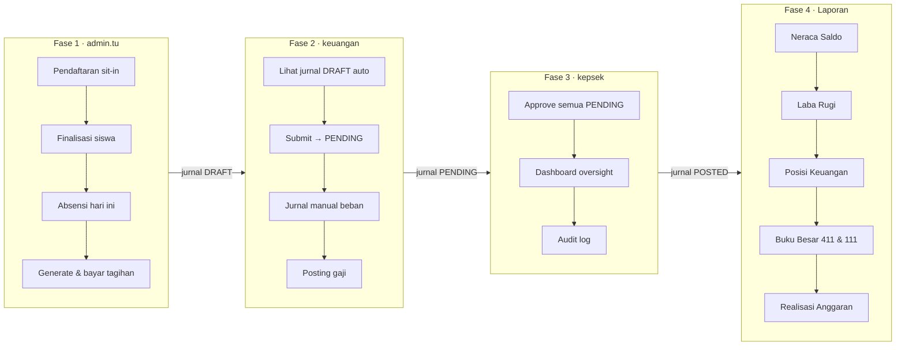

# Skrip Demo Sidang — BeeSmart Finance (3 Role)

> **Untuk:** Ujian skripsi / demo penguji  
> **Role:** `admin.tu` → `keuangan` → `kepsek` (exclude `guru.kegiatan`)  
> **Durasi:** ~45–55 menit (versi lengkap) · ~30 menit (versi fast-track di §9)  
> **Output akhir:** Jurnal POSTED + **Laporan Keuangan** (neraca saldo, laba rugi, posisi keuangan, buku besar, realisasi anggaran)

---

## 0. Persiapan (H-1 atau 30 menit sebelum sidang)

### 0.1 Jalankan stack

```bash
# Terminal 1 — backend
cd backend
python manage.py migrate
python manage.py import_coa_final --seed-rules   # pastikan COA ≥180 akun
python manage.py seed_system_posting_rules
python manage.py runserver 8000

# Terminal 2 — frontend
cd frontend
npm run dev
# Buka http://localhost:5173 — hard refresh (Cmd+Shift+R)
```

### 0.2 Verifikasi cepat

```bash
cd backend
python manage.py uat_walkthrough   # target: 64/64 pass
```

### 0.3 Akun demo

| Username | Persona | Password |
|----------|---------|----------|
| `admin.tu` | Bu Fitri — Staf TU | `<password demo dari seed lokal>` |
| `keuangan` | Staff Keuangan | `<password demo dari seed lokal>` |
| `kepsek` | Pak Ali — Kepala Sekolah | `<password demo dari seed lokal>` |

### 0.4 Data demo yang disiapkan

| Item | Nilai saran | Catatan |
|------|-------------|---------|
| Bulan demo | **Juli 2026** | Sesuaikan dengan bulan sidang |
| Siswa existing | Pilih 1 siswa **belum punya tagihan Juli** (mis. cari di `/tagihan` filter Juli) |
| Calon baru | Nama unik: **"Alvio Demo Sidang"** | Untuk alur pendaftaran |
| Tarif katering | Rp 20.000/hari | Default operasional |
| SPP finalisasi | Rp 400.000/bulan | Saat finalisasi pendaftaran |

### 0.5 Yang akan diceritakan ke penguji (elevator pitch)

> *"Sistem ini menghubungkan operasional harian TU — absensi, tagihan, pendaftaran — dengan akuntansi double-entry. Setiap pembayaran otomatis membuat jurnal DRAFT. Staff Keuangan submit, Kepala Sekolah approve (maker-checker). Laporan keuangan hanya menghitung jurnal POSTED."*

### 0.6 Glosarium istilah akuntansi (untuk narasi sidang)

Bagian ini menjelaskan istilah yang muncul di demo — supaya kamu bisa menjelaskan ke penguji dengan bahasa yang benar secara akuntansi, tanpa kehilangan konteks sistem.

---

#### A. Prinsip dasar

| Istilah | Artinya | Di BeeSmart Finance |
|---------|---------|---------------------|
| **Double-entry** (pembukuan berpasangan) | Setiap transaksi dicatat minimal di **dua akun**: satu sisi debit, satu sisi kredit, dengan **total nilai yang sama**. Tidak ada transaksi "setengah" — selalu berpasangan. | Setiap bayar tagihan, sit-in, gaji, dll. menghasilkan jurnal dengan baris debit + kredit yang **seimbang**. Sistem menolak jurnal jika total debit ≠ total kredit. |
| **Debit (Dr)** | Sisi **kiri** jurnal. Untuk akun bertipe **aset** dan **beban**, penambahan biasanya di-debit. | Contoh: siswa bayar SPP → **Kas di Tangan (111) di-debit** karena uang masuk ke kas. |
| **Kredit (Cr)** | Sisi **kanan** jurnal. Untuk akun **liabilitas**, **ekuitas**, dan **pendapatan**, penambahan biasanya di-kredit. | Contoh: bayar SPP → **Pendapatan SPP (411) di-kredit** karena sekolah mengakui pendapatan. |
| **Posisi normal** | Kebiasaan saldo akun: **D** = debit normal (aset, beban), **K** = kredit normal (liabilitas, ekuitas, pendapatan). | Terlihat di menu **Daftar Akun (COA)** kolom posisi. |

**Contoh double-entry saat ortu bayar tagihan SPP Rp 400.000:**

```
Dr  Kas di Tangan (111)          400.000
    Cr  Pendapatan SPP (411)            400.000
```

**Narasi sidang:** *"Ini double-entry klasik: kas bertambah di debit, pendapatan diakui di kredit, nilainya sama."*

---

#### B. Bagan akun & pencatatan

| Istilah | Artinya | Di sistem |
|---------|---------|-----------|
| **COA** (Chart of Accounts / Daftar Akun) | Daftar induk semua akun akuntansi sekolah, berkode hierarkis (mis. `111`, `411`, `5301`). | Menu **Daftar Akun** — ~190 akun dari COA Final TK Lebah Madu. Sumber kebenaran untuk dropdown jurnal & laporan. |
| **Golongan / Sub-golongan** | Hierarki pengelompokan akun (Aset, Liabilitas, Ekuitas, Pendapatan, Beban). | Tab di halaman COA. Contoh: `41` = Pendapatan Usaha, di bawahnya `411` SPP. |
| **Jurnal** (journal entry) | Bukti formal pencatatan transaksi: tanggal, no. bukti, keterangan, dan baris debit/kredit per akun. | Menu **Pemasukan** & **Pengeluaran**. Bisa manual (keuangan) atau **otomatis** (dari tagihan, gaji, pendaftaran). |
| **No. bukti** | Nomor referensi unik per jurnal (audit trail). | Contoh: `SIT-3` (sit-in), `REG-3` (pendaftaran), `TAG-…` (tagihan), `DEMO-BEBAN-001` (manual). |
| **Auto-posting** | Sistem membuat jurnal otomatis dari transaksi operasional, tanpa input debit/kredit manual. | TU klik **Bayar Tagihan** → sistem generate jurnal DRAFT. Mapping akun lewat aturan posting (SPP→411, Sit-in→416, dll.). |
| **Buku besar** (general ledger) | Riwayat **per akun**: setiap mutasi debit/kredit + **saldo berjalan** setelah transaksi. | Tab **Buku Besar** di menu Laporan. Pilih akun (mis. `411`) → lihat baris per no. bukti. |

---

#### C. Klasifikasi akun (5 kelompok utama)

| Kelompok | Kode COA | Contoh di demo | Naik di sisi |
|----------|----------|----------------|--------------|
| **Aset** | 1xx | `111` Kas di Tangan, `114` Piutang Karyawan | Debit |
| **Liabilitas** | 2xx | `211` Utang Gaji Pegawai | Kredit |
| **Ekuitas** | 3xx | `311` Modal, `312` Laba Ditahan | Kredit |
| **Pendapatan** | 4xx | `411` SPP, `415` Formulir, `416` Sit-in | Kredit |
| **Beban** | 5xx | `5101` Beban operasional, `5301` Beban gaji | Debit |

**Narasi:** *"Sekolah nirlaba tidak punya 'laba' dalam arti komersial — kelebihan pendapatan atas beban disebut **surplus**, kekurangannya **defisit** (ISAK 35)."*

---

#### D. Siklus jurnal & kontrol internal

| Istilah | Artinya | Alur di demo |
|---------|---------|--------------|
| **DRAFT** | Jurnal sudah tercatat tapi **belum final** — belum masuk laporan keuangan. | Dibuat otomatis saat TU bayar tagihan / sit-in, atau saat keuangan simpan jurnal manual. |
| **PENDING** | Jurnal sudah **diajukan** ke Kepsek, menunggu persetujuan. | Keuangan klik **Submit** setelah review. |
| **POSTED** | Jurnal **disetujui** dan **masuk buku besar** — sumber semua laporan. | Kepsek klik **Approve**. Baru setelah ini angka muncul di neraca saldo, laba rugi, buku besar. |
| **Maker-checker** | Pemisahan peran: yang **buat/ajukan** (maker) ≠ yang **setujui** (checker). | Keuangan = maker (buat + submit). Kepsek = checker (approve). |
| **SoD** (Segregation of Duties) | Kepala sekolah **tidak boleh** approve jurnal yang dia sendiri buat; keuangan juga tidak bisa approve. | Ditegakkan di backend — coba approve sebagai keuangan → ditolak. |
| **Void / pembalik** | Membatalkan jurnal POSTED dengan jurnal pembalik (reversal). | Fitur Kepsek di menu jurnal (tidak wajib didemo live). |

**Analogi sederhana untuk penguji:**

> *DRAFT = rancangan · PENDING = menunggu tanda tangan Kepsek · POSTED = sudah di buku besar resmi.*

---

#### E. Laporan keuangan (output akhir demo)

| Laporan | Istilah akuntansi | Apa yang ditampilkan | Kapan dipakai di demo |
|---------|-------------------|----------------------|------------------------|
| **Neraca Saldo** | Trial balance | Daftar **semua akun** + total debit, total kredit, saldo akhir per akun. Cek keseimbangan sebelum laporan formal. | Fase 4 — tab pertama. Tunjuk `111`, `411`, `5301`. |
| **Laba Rugi** | Income statement / statement of activities | **Pendapatan (4xx)** dikurangi **Beban (5xx)** = surplus atau defisit periode. | Fase 4 — jelaskan kontribusi tagihan & gaji ke angka ini. |
| **Posisi Keuangan** | Balance sheet / statement of financial position | **Aset** di satu sisi; **Liabilitas + Ekuitas** di sisi lain. Harus seimbang. | Fase 4 — tunjuk struktur ISAK 35 nirlaba. |
| **Buku Besar** | General ledger | Mutasi **satu akun** detail: tanggal, bukti, debet, kredit, saldo berjalan. | **Klimaks demo** — akun `411` dan `111`. |
| **Realisasi Anggaran** | Budget vs actual | **Pagu** (rencana) vs **realisasi** (pengeluaran aktual) per akun beban. | Fase 4 — monitoring internal sekolah. |

**Catatan penting untuk penguji:**

> Semua laporan dihitung dari jurnal berstatus **POSTED** saja. DRAFT dan PENDING **tidak** mempengaruhi angka — ini sengaja agar laporan hanya berisi transaksi yang sudah disetujui Kepsek.

---

#### F. Istilah operasional yang terhubung ke akuntansi

| Istilah operasional | Dampak akuntansi |
|---------------------|------------------|
| **Sit-in / trial** | Dr Kas, Cr Pendapatan Sit-in (`416`) |
| **Biaya pendaftaran** | Dr Kas, Cr Pendapatan Formulir (`415`) |
| **Tagihan SPP** | Dr Kas, Cr Pendapatan SPP (`411`) |
| **Tagihan katering / jemputan** | Dr Kas, Cr Pendapatan lain (`417` atau `412`) |
| **Posting gaji** | Dr Beban Gaji (`5301`), Dr/Cr Piutang & Utang, Cr Kas (`111`) |
| **Kasbon pegawai** | Dr Piutang Karyawan (`114`), Cr Kas — saat cair |

---

#### G. Contoh narasi lengkap (1 transaksi, 30 detik)

Saat demo **Bayar Tagihan** di Fase 1, kamu bisa bilang:

> *"Bu Fitri hanya klik Bayar — dia tidak perlu tahu debit kredit. Di belakang layar, sistem menerapkan **double-entry**: Kas di Tangan di-debit karena uang masuk, Pendapatan SPP di-kredit karena sekolah mengakui penghasilan. Jurnal masuk status **DRAFT**. Nanti Staff Keuangan **submit**, Kepala Sekolah **approve** menjadi **POSTED**, baru tercermin di **buku besar** akun 411 dan **neraca saldo**."*

---

#### H. Pertanyaan penguji soal teori akuntansi

| Pertanyaan | Jawaban singkat |
|------------|-----------------|
| *"Apa itu double-entry?"* | Setiap transaksi berdampak ke minimal 2 akun, total debit = total kredit. |
| *"Kenapa bayar SPP debit kas, bukan kredit?"* | Kas adalah aset; aset bertambah di sisi debit. Pendapatan bertambah di kredit. |
| *"Bedanya neraca saldo dan posisi keuangan?"* | Neraca saldo = trial balance semua akun. Posisi keuangan = laporan formal Aset vs Liabilitas+Ekuitas. |
| *"Bedanya laba rugi dan buku besar?"* | Laba rugi = ringkasan pendapatan vs beban. Buku besar = detail mutasi per satu akun. |
| *"Kenapa pakai maker-checker?"* | Kontrol internal: cegah fraud/error — yang mencatat tidak boleh menyetujui sendiri. |
| *"Apakah ini sesuai ISAK 35?"* | Ya, entitas nirlaba: laporan aktivitas (surplus/defisit) + posisi keuangan, bukan laba untuk pembagian pemilik. |

---

## 1. Peta alur demo (big picture)



**Prinsip penting untuk penguji:**

| Status jurnal | Siapa | Keterangan |
|---------------|-------|------------|
| **DRAFT** | Auto dari TU / Keuangan | Belum masuk laporan |
| **PENDING** | Setelah Keuangan Submit | Menunggu approval |
| **POSTED** | Setelah Kepsek Approve | **Masuk buku besar & laporan** |

---

## 2. Fase 1 — Bu Fitri (`admin.tu`) · Operasional → Jurnal DRAFT

**Login:** `admin.tu` / `<password demo dari seed lokal>`  
**Home:** `/siswa`  
**Durasi:** ~15 menit

---

### Step 1.1 — Pendaftaran calon siswa baru

**Menu:** Sidebar → **Pendaftaran**

| Langkah | Aksi | Yang ditunjukkan ke penguji |
|---------|------|----------------------------|
| 1 | Klik **+ Daftar Calon** | Form pendaftaran |
| 2 | Isi: Nama = `Alvio Demo Sidang`, Tanggal = hari ini | Data calon |
| 3 | Biaya Sit-in = `100000`, Biaya Pendaftaran = `500000` | Komponen biaya |
| 4 | Simpan | Status: **Sit-in / Trial** |

**Narasi:** *"Calon siswa mendaftar sit-in dulu sebelum jadi siswa resmi."*

---

### Step 1.2 — Bayar sit-in

| Langkah | Aksi | Expected |
|---------|------|----------|
| 1 | Klik **Bayar Sit-in** pada baris Alvio | Toast sukses |
| 2 | Perhatikan kolom **Jurnal Sit-in** | Berubah dari "Belum" → ada referensi |

**Narasi:** *"Pembayaran sit-in otomatis jurnal: Dr Kas (111), Cr Pendapatan Sit In (416). Status DRAFT — belum masuk laporan."*

**Akun yang terlibat:** `111` Kas · `416` Pendapatan Sit In/Observasi

---

### Step 1.3 — Finalisasi menjadi siswa resmi

| Langkah | Aksi | Expected |
|---------|------|----------|
| 1 | Klik **Finalisasi** | Modal terbuka |
| 2 | Nominal SPP bulanan = `400000` | |
| 3 | Klik **Finalisasi** | Status → **Registered** |

**Narasi:** *"Setelah diterima, biaya pendaftaran dijurnal: Dr Kas, Cr Pendapatan Formulir (415). Sekaligus membuat record siswa baru."*

**Cek:** Buka **Data Siswa** → Alvio muncul di list.

**Akun:** `415` Pendapatan Formulir

---

### Step 1.4 — Input absensi hari ini

**Menu:** **Absensi Siswa**

| Langkah | Aksi | Expected |
|---------|------|----------|
| 1 | Pilih tanggal = hari ini | Grid siswa muncul |
| 2 | Untuk siswa demo (Alvio atau siswa existing): **Hadir** ✓ | |
| 3 | Centang **Katering** (opsional) | Untuk komponen tagihan katering |
| 4 | Centang **Jemput Datang/Pulang** (opsional) | Untuk komponen jemputan |
| 5 | **Simpan** | Toast sukses |

**Narasi:** *"Absensi harian jadi dasar perhitungan tagihan katering & jemputan."*

---

### Step 1.5 — Generate & bayar tagihan bulan Juli

**Menu:** **Tagihan**

| Langkah | Aksi | Expected |
|---------|------|----------|
| 1 | Klik **Buat Tagihan** | Modal |
| 2 | Pilih siswa, Bulan = **Juli**, Tahun = **2026** | |
| 3 | Tarif Katering = `20000` (jika pakai katering) | |
| 4 | Klik **Preview & Edit** | Rincian: SPP, Katering, Jemputan, dll. |
| 5 | Review komponen → **Simpan** | Tagihan status **BELUM** |
| 6 | Klik **Bayar** pada tagihan tersebut | Status → **LUNAS** |
| 7 | Klik **Cetak Struk** / preview invoice | Struk untuk ortu |

**Narasi:** *"Tagihan digenerate dari SPP + absensi. Saat dibayar, sistem buat jurnal DRAFT per komponen: Dr Kas, Cr Pendapatan (411 SPP, 417 katering, dll)."*

**Akun kunci:** `411` SPP · `417` Pendapatan lain · `111` Kas

---

### Step 1.6 — Tunjukkan RBAC (opsional, 30 detik)

| Langkah | Aksi | Expected |
|---------|------|----------|
| 1 | Ketik manual di address bar: `/dashboard` | Redirect ke `/siswa` + pesan akses |
| 2 | Ketik `/coa` | Redirect — TU tidak punya menu keuangan |

**Narasi:** *"Pemisahan tugas: TU operasional, tidak akses modul akuntansi."*

---

### Step 1.7 — Logout

Klik **Logout** di pojok kanan atas.

**Checkpoint Fase 1:** Minimal **3 jurnal DRAFT** baru terbuat (sit-in, pendaftaran, tagihan).

---

## 3. Fase 2 — Staff Keuangan (`keuangan`) · Akuntansi & Submit

**Login:** `keuangan` / `<password demo dari seed lokal>`  
**Home:** `/dashboard`  
**Durasi:** ~15 menit

---

### Step 2.1 — Dashboard keuangan

**Menu:** **Beranda**

| Yang ditunjukkan | Narasi |
|------------------|--------|
| KPI kas, pendapatan, beban | *"Ringkasan keuangan real-time dari jurnal POSTED + operasional."* |
| Filter bulan/tahun = Juli 2026 | *"Dashboard bisa difilter periode."* |
| Widget jurnal pending (jika ada) | *"Jurnal menunggu approval Kepsek."* |
| Widget tunggakan tagihan | *"Keuangan memantau piutang siswa."* |

---

### Step 2.2 — Review jurnal DRAFT dari operasional TU

**Menu:** Sidebar → **Pemasukan** (`/jurnal?jenis=masuk`)

| Langkah | Aksi | Expected |
|---------|------|----------|
| 1 | Filter status = **Draft** | Muncul jurnal auto: SIT-*, REG-*, TAG-* |
| 2 | Buka detail 1 jurnal tagihan | Baris: Dr `111` Kas, Cr `411` SPP (dan komponen lain) |
| 3 | Jelaskan double-entry | Debit = Kredit |

**Narasi:** *"Jurnal otomatis dari TU masuk sebagai DRAFT. Keuangan review sebelum diajukan ke Kepsek."*

---

### Step 2.3 — Submit jurnal → PENDING (maker)

Ulangi untuk **semua jurnal DRAFT** dari demo (minimal 3):

| Langkah | Aksi | Expected |
|---------|------|----------|
| 1 | Klik ikon **Submit** (✈️) pada jurnal DRAFT | Status → **PENDING** |
| 2 | Toast: *"Jurnal diajukan — menunggu persetujuan Kepala Sekolah"* | |

**Narasi:** *"Maker-checker: Keuangan sebagai maker mengajukan, tidak bisa approve sendiri (SoD)."*

---

### Step 2.4 — Buat jurnal manual pengeluaran

**Menu:** **Pengeluaran** (`/jurnal?jenis=keluar`)

| Langkah | Aksi | Expected |
|---------|------|----------|
| 1 | Klik **Buat Jurnal** | Modal |
| 2 | No. Bukti = `DEMO-BEBAN-001`, Tanggal = hari ini | |
| 3 | Keterangan = `Beban operasional demo sidang` | |
| 4 | Baris 1: Akun beban `5101` (atau 5xxx lain) — **Debit** `500000` | Dropdown akun beban lengkap |
| 5 | Baris 2: Akun `111` Kas — **Kredit** `500000` | Jurnal seimbang |
| 6 | **Simpan (DRAFT)** → **Submit** | Status PENDING |

**Narasi:** *"Keuangan juga bisa input jurnal manual. Dropdown akun sudah terhubung COA Final (~190 akun)."*

---

### Step 2.5 — Posting gaji (jika belum posted bulan ini)

**Menu:** Sidebar → **Gaji**

| Langkah | Aksi | Expected |
|---------|------|----------|
| 1 | Pilih pegawai, periode Juli 2026 | |
| 2 | Buat slip baru ATAU buka slip existing | |
| 3 | Klik **Posting** | Jurnal DRAFT: Dr `5301` Beban Gaji, Cr `111` Kas, `114` Piutang, `211` Utang |
| 4 | Buka **Pengeluaran** → Submit jurnal gaji | Status PENDING |

**Narasi:** *"Payroll terintegrasi COA Final — tidak hardcode lagi."*

**Skip jika:** Sudah diposting (toast "sudah dijurnal") — tunjukkan jurnal existing saja.

---

### Step 2.6 — COA & buku besar (teaser sebelum laporan penuh)

**Menu:** **Daftar Akun** → tunjukkan ≥180 akun (5 detik)

**Menu:** **Laporan** → tab **Buku Besar** → pilih akun `411` → **belum ada mutasi POSTED** (karena belum di-approve)

**Narasi:** *"Laporan hanya dari jurnal POSTED. Setelah Kepsek approve, baris mutasi akan muncul di sini."*

---

### Step 2.7 — Logout

**Checkpoint Fase 2:** Minimal **4–5 jurnal PENDING** (tagihan, sit-in, pendaftaran, beban manual, gaji).

---

## 4. Fase 3 — Pak Ali (`kepsek`) · Governance & Approve

**Login:** `kepsek` / `<password demo dari seed lokal>`  
**Home:** `/dashboard`  
**Durasi:** ~10 menit

---

### Step 3.1 — Dashboard kepala sekolah

| Yang ditunjukkan | Narasi |
|------------------|--------|
| KPI operasional (siswa aktif, kehadiran) | *"Kepsek lihat kesehatan operasional + keuangan sekilas."* |
| Grafik absensi sparkline | Data legacy + real-time |
| Jurnal pending count | *"Ada jurnal menunggu approval."* |

---

### Step 3.2 — Approve jurnal (checker)

**Menu:** **Pemasukan** + **Pengeluaran** (keduanya `/jurnal`)

| Langkah | Aksi | Expected |
|---------|------|----------|
| 1 | Filter status = **Pending** | List jurnal dari Keuangan |
| 2 | Review 1 jurnal → klik **Approve** (✓) | Status → **POSTED** |
| 3 | Ulangi untuk **semua PENDING** dari demo | |

**Narasi:** *"Kepsek sebagai checker. SoD: approver tidak boleh sama dengan pembuat jurnal. Setelah POSTED, transaksi masuk buku besar."*

**Coba tunjukkan SoD (opsional):** Login keuangan → coba approve → **ditolak 403**.

---

### Step 3.3 — COA read-only

**Menu:** **Daftar Akun**

| Yang ditunjukkan | Narasi |
|------------------|--------|
| Banner *"mode lihat saja"* | Kepsek oversight tanpa ubah COA |
| Tidak ada tombol Tambah/Edit/Hapus | RBAC |

---

### Step 3.4 — Audit log

**Menu:** **Log Audit**

| Langkah | Aksi | Expected |
|---------|------|----------|
| 1 | Scroll list audit | Entri approve, bayar tagihan, dll. |
| 2 | Klik detail 1 entri | JSON perubahan |

**Narasi:** *"Jejak audit untuk akuntabilitas — siapa approve, kapan."*

---

### Step 3.5 — Logout

**Checkpoint Fase 3:** Semua jurnal demo = **POSTED**.

---

## 5. Fase 4 — Grand Finale: Laporan Keuangan (output akuntansi)

**Login:** `keuangan` atau `kepsek` (keduanya bisa)  
**Menu:** **Laporan** (`/laporan`)  
**Durasi:** ~10–12 menit — **ini klimaks demo**

> Set **Periode = Juli 2026** → klik **Terapkan**

---

### Step 4.1 — Tab Neraca Saldo

| Yang ditunjukkan | Narasi |
|------------------|--------|
| Tabel semua akun: kode, nama, total debit/kredit, saldo | *"Trial balance — fondasi laporan keuangan."* |
| Akun `111` Kas — saldo debit | Kas bertambah dari pembayaran |
| Akun `411` SPP — saldo kredit | Pendapatan SPP |
| Akun `5301` — saldo debit | Beban gaji |
| Tombol **Export CSV** | Bisa diekspor untuk Excel |

---

### Step 4.2 — Tab Laba Rugi

| Yang ditunjukkan | Narasi |
|------------------|--------|
| Total pendapatan (akun 4xx) | Dari tagihan + pendaftaran + sit-in |
| Total beban (akun 5xx) | Dari gaji + beban manual |
| **Surplus / Defisit** | Pendapatan − Beban |

**Narasi:** *"Laporan laba rugi periode tahun berjalan — selaras ISAK 35 untuk entitas nirlaba."*

---

### Step 4.3 — Tab Posisi Keuangan

| Yang ditunjukkan | Narasi |
|------------------|--------|
| Bagian **Aset** (1xx) | Kas, piutang, aset tetap |
| Bagian **Liabilitas** (2xx) | Utang gaji, dll. |
| Bagian **Ekuitas** (3xx) | Modal, laba ditahan |
| Total aset = Total liabilitas + ekuitas | *"Neraca seimbang"* |

---

### Step 4.4 — Tab Buku Besar ⭐ (penting untuk penguji akuntansi)

| Langkah | Aksi | Expected |
|---------|------|----------|
| 1 | Pilih akun **`411` — SPP** | |
| 2 | Klik muat / terapkan periode | Tabel mutasi: tanggal, no bukti, debit, kredit, **saldo berjalan** |
| 3 | Tunjukkan baris dari tagihan demo | No. bukti TAG-* atau serupa |
| 4 | Ulangi untuk akun **`111` — Kas di Tangan** | Mutasi debit dari pembayaran |
| 5 | (Opsional) Akun **`416`** sit-in, **`415`** pendaftaran | Alur pendaftaran terekam |

**Narasi:** *"Buku besar per akun — bukti double-entry terlihat jelas: setiap pembayaran siswa meningkatkan kas (debit) dan pendapatan (kredit)."*

---

### Step 4.5 — Tab Realisasi Anggaran

| Yang ditunjukkan | Narasi |
|------------------|--------|
| Pagu vs realisasi per akun beban | Monitoring anggaran |
| Progress bar utilisasi | *"Kepsek & keuangan pantau apakah beban mendekati pagu."* |

---

### Step 4.6 — Tutup demo: kaitkan balik ke awal

**Ringkasan 30 detik ke penguji:**

1. TU input operasional → tagihan & pendaftaran  
2. Sistem auto-jurnal DRAFT (double-entry)  
3. Keuangan submit → Kepsek approve (maker-checker)  
4. Laporan keuangan dari jurnal POSTED: neraca saldo, laba rugi, posisi keuangan, **buku besar**  
5. Audit log untuk accountability  

---

## 6. Checklist output akhir (harus kelihatan di layar)

Centang sebelum akhiri demo:

- [ ] Siswa baru **Alvio Demo Sidang** ada di Data Siswa
- [ ] Tagihan Juli **LUNAS** + struk tercetak
- [ ] Jurnal tagihan / sit-in / pendaftaran status **POSTED**
- [ ] Jurnal beban manual + gaji status **POSTED**
- [ ] **Neraca Saldo** — akun 111, 411, 5301 ada saldo
- [ ] **Laba Rugi** — pendapatan & beban terisi, surplus/defisit tampil
- [ ] **Posisi Keuangan** — aset = liabilitas + ekuitas
- [ ] **Buku Besar 411** — mutasi tagihan SPP dengan saldo berjalan
- [ ] **Buku Besar 111** — mutasi kas dari pembayaran
- [ ] **Audit log** — entri approve & operasional

---

## 7. Mapping transaksi demo → akun COA (cheat sheet)

| Transaksi | Jurnal (DR → CR) | Akun COA Final |
|-----------|------------------|----------------|
| Bayar sit-in | Kas → Pendapatan | `111` → `416` |
| Finalisasi pendaftaran | Kas → Pendapatan | `111` → `415` |
| Bayar tagihan SPP | Kas → Pendapatan | `111` → `411` |
| Bayar tagihan katering | Kas → Pendapatan | `111` → `417` |
| Posting gaji | Beban Gaji, Piutang → Kas, Utang | `5301`, `114` → `111`, `211` |
| Beban manual | Beban operasional → Kas | `5101` → `111` |

---

## 8. Pertanyaan penguji & jawaban siap

> Istilah akuntansi lengkap: lihat **§0.6 Glosarium**.

| Pertanyaan | Jawaban singkat |
|------------|-----------------|
| *"Apa itu double-entry di sistem ini?"* | Setiap bayar tagihan/gaji/pendaftaran → jurnal otomatis Dr + Cr seimbang. Lihat §0.6A. |
| *"Bedanya DRAFT dan POSTED?"* | DRAFT belum final; POSTED sudah di-approve Kepsek dan masuk laporan. |
| *"Siapa yang bisa approve?"* | Hanya Kepsek. Keuangan tidak bisa approve jurnal sendiri (SoD). |
| *"Dari mana angka di buku besar?"* | Mutasi jurnal POSTED per akun, dihitung saldo berjalan. |
| *"Bedanya neraca saldo & buku besar?"* | Neraca saldo = ringkasan semua akun; buku besar = detail satu akun. |
| *"Kenapa TU tidak lihat COA?"* | RBAC — pemisahan operasional vs akuntansi. |
| *"COA dari mana?"* | Import COA Final sekolah (~190 akun), bukan hardcode. |
| *"Kalau akun belum diset?"* | Sistem resolve otomatis dari COA Final + pesan ramah ke user. |

---

## 9. Versi Fast-Track (~30 menit)

Jika waktu sidang terbatas:

| # | Role | Aksi | Waktu |
|---|------|------|-------|
| 1 | admin.tu | Bayar tagihan 1 siswa (skip pendaftaran) | 5 m |
| 2 | keuangan | Submit jurnal tagihan + 1 jurnal beban manual | 5 m |
| 3 | keuangan | Posting gaji (atau skip) | 3 m |
| 4 | kepsek | Approve semua PENDING | 5 m |
| 5 | keuangan | **Laporan:** Neraca → LR → **Buku Besar 411 & 111** | 10 m |
| 6 | kepsek | Dashboard + audit log | 2 m |

---

## 10. Troubleshooting saat demo live

| Gejala | Solusi cepat |
|--------|--------------|
| Preview tagihan error | `python manage.py seed_system_posting_rules` + restart backend |
| Posting gaji gagal | Pastikan COA `5301`, `111`, `114`, `211` ada |
| Buku besar kosong | Pastikan jurnal sudah **POSTED** (bukan DRAFT/PENDING) |
| Laporan angka 0 | Filter tahun = 2026, bulan Juli |
| "Akses ditolak" popup | Normal saat ganti role — login ulang role yang benar |
| Dropdown akun sedikit | `import_coa_final` belum jalan — 190 akun |

---

## Quick Links

| Dokumen | Path |
|---------|------|
| UAT readiness | [15-UAT-DEPLOY-READINESS.md](./15-UAT-DEPLOY-READINESS.md) |
| Feedback dosen / checklist | [14-DOSEN-FEEDBACK-GUIDE.md](./14-DOSEN-FEEDBACK-GUIDE.md) |
| Walkthrough otomatis | `python manage.py uat_walkthrough` |
| Akun demo | [12-BACKEND-REFERENCE.md](./12-BACKEND-REFERENCE.md) § Seed Users |
